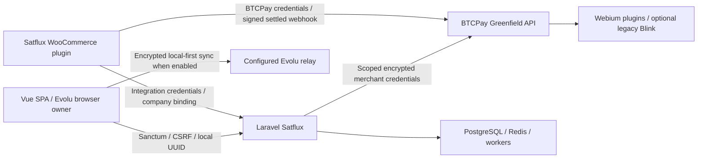

# Satflux ecosystem architecture

## Independent projects

[workspace/projects.yaml](../../workspace/projects.yaml) is the central registry.
Paths resolve from the Satflux root, with environment overrides for alternative
checkouts. Every Git repository retains its history, branches, PRs, tests, versions
and releases. The infrastructure entry is a component of Satflux, not an invented
separate repository. External repositories are read-only during bootstrap.

Satflux is a Laravel 12 API and Vue 3/TypeScript SPA using PostgreSQL 16 and Redis 7.
Sanctum authenticates browser sessions; Axios uses CSRF-protected `/api` requests.
Pinia and Vue Router coordinate UI state. Legacy server-side invoicing and optional
Evolu local-first encrypted invoicing coexist. Nostr and optional Evolu relay services
are integrations; no separate local relay repository was established by discovery.
Reverb is a distinct server-side realtime service, not an Evolu relay.

## BTCPay provider contracts

The maintained distribution is `webiumsk/BTCPayServerPluginsWebium`. Satflux calls
store-scoped Greenfield endpoints for LNAddressConnect, CashuMelt, Satflux Tickets,
SEPA Instant QR and Raffle. Satflux Tickets uses `satflux-tickets` routes and its own
plugin identity; preserve legacy `satoshi-tickets` aliases. Other installed plugins
must not be disabled merely because they are absent from the minimal installer set.

LNAddressConnect covers Lightning Address providers, including Blink/Flash/Blitz
where their receiving/verification contracts are supported. Optional Kukks Blink
supports existing API connections. Separate Blitz/Flash are not required in the
minimal installation set. NWC remains deferred. Linky/LUD-21 feasibility and wallet
verification must rely on actual settlement evidence, not provider branding.

Recent plugin work targets net10.0 and tests the exact BTCPay 2.4.5 host commit
`5d0745cae6be5d8210459e38813f317673aa97b8`. A manifest declaring `>=2.4.5` does not
certify every newer host. The separately discovered BTCPay fork checkout is not
automatically the pinned dependency used by those builds. Resolve the chosen plugin
checkout and run its host guard before building or packaging.

Cashu recovery APIs require store modification permission and original mint/payout
evidence. Satflux's newer merchant recovery UI depends on corresponding plugin
endpoints. An older plugin must fail safely with an actionable compatibility error.
Cashu mint trust and temporary encrypted spendable proofs in BTCPay mean the entire
route cannot be described as wholly non-custodial. Satflux receives no spendable proofs.
Unknown or interrupted settlement cannot mark an invoice paid or authorize a wallet
change. Restore paths must remain idempotent and avoid repeated payout.

## WooCommerce consumer contracts

The separate distribution is `webiumsk/satflux-woocommerce`, discovered under a
historically named local directory. The entry header is version 2.0.23. README and
legacy instruction files contain older versions and flows; preserve and flag them.

Satflux/WordPress connection uses a one-time authorization code exchange via
`/api/integrations/woocommerce/oauth-exchange`; treat codes as secrets. Integration
tokens and webhook HMAC secrets are bound to store/company, with server-side checks.
BTCPay settled webhooks drive WooCommerce payment state. HPOS/Blocks declarations
require functional verification, not assumptions from header metadata.

WooCommerce invoicing sends orders to the Satflux company inbox. Local-first drafts
require owner review before issuance. The cached `invoicing_enabled` flag and Pro
marketing copy are future promotional-audit inputs; client flags never grant
authorization. Company changes must preserve history and invalidate stale authority.

## Trust boundaries

- Browser sessions, integration bearer tokens and BTCPay API keys are different
  authentication mechanisms. Sanctum's SPA cookie model does not eliminate token APIs.
- Store ownership and audited admin/support exceptions are separate from paid plan
  access. Company and tenant scoping remain mandatory during any promotion.
- Provisioning keys stay separate from encrypted per-merchant credentials. Browser
  APIs normally expose local IDs; retain only the documented existing embed exception.
- Webhook signatures and secret lookup fail closed. Preserve replay/idempotency checks.
- Recovery phrases/private keys stay out of server reports/logs. Local-first encrypted
  data, passkey envelopes and legacy server documents require their existing policies.
- Back up the Cashu plugin database together with ASP.NET Data Protection keys;
  mixed worker versions and unreviewed downgrades can break recoverability.

## Shared tests and releases

Satflux CI runs PHPUnit, Pint, Larastan/PHPStan baseline and Composer audit; frontend
lint/typecheck ratchets, EN/SK/ES/DE/CS parity, Vitest and production build; Playwright
uses isolated SQLite, a BTCPay stub and disabled relay. Local tests must verify
effective environment and cached configuration first. Do not reuse production targets.

Current plugin CI uses a guarded exact host build and disposable PostgreSQL 17 for
plugin suites. That database version is a test host, distinct from Satflux's stack.
WooCommerce has release packaging but no discovered comprehensive automated suite;
require isolated WordPress/WooCommerce integration coverage for future changes.

Merge provider contracts before dependent consumers where compatible; publish/install
validated plugin packages before Satflux requires their endpoints, then compatible
WooCommerce consumers. Main prepares separate PRs, artifact checksums, tested version
matrix, migration/backup requirements and rollback constraints. Product Owner approval
is required before applicable release/deployment actions. No release is performed by
this bootstrap.
